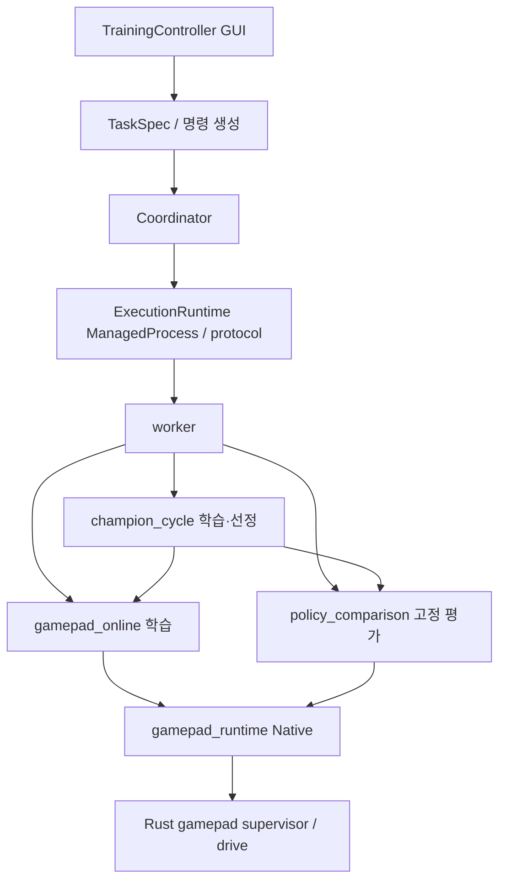

# 프로젝트 구조와 실행 경계

2026-11-09. 기존 작업 트리의 구현을 보존한 책임 분리다. 학습 알고리즘·보상·선정 기준·저장 스키마는 변경하지 않았으며, 실게임 실행 보류는 루트 AGENTS.md를 따른다.

## 데이터와 모델

| 영역 | 담당 |
| --- | --- |
| TelemetryDataServer / DrivingRecorder | 관측, 주행 기록, 랩 경계 |
| DatasetBuilder / TrackModel / StateProcessor | 기록 선별, 기준 경로, 차량 상태 |
| ModelTrainer / TrainingEnvironment / Evaluator | 모델 학습, 회차 실행, 고정 정책 평가 |
| GamepadIO / VirtualJoyStick / ModelAndActuator | 장치 입력, 제어 및 안전 감시 |
| TrainingController / ExecutionRuntime | 작업 선택과 화면, 프로세스·관리 프로토콜 |

Rust 워크스페이스의 9개 크레이트와 기존 Python 패키지 진입점은 유지한다. 실험 스크립트, TOML·JSON 프리셋, 기존 모델·경험·결과 폴더는 이동하지 않는다.

## GUI와 작업 정의

`python -m TrainingController`는 `ui.Controller`를 연다. `task_view`는 작업 입력·설정 미리보기·프리셋 적용, `result_view`는 결과 목록·체크포인트 선택을 담당한다. 테스트는 `Controller(..., workspace=임시경로)`로 실제 결과 폴더와 분리할 수 있다.

`task_catalog.TaskSpec`은 작업 ID·표시 이름·그룹·필드·기본 설정·재개 지원·시간 제한·실행 방식·명령 생성기·worker handler의 원본이다. GUI와 worker는 이 목록을 함께 사용한다. handler는 선택된 작업 실행 시 불러오므로 작업 목록을 읽는 것만으로 학습 라이브러리를 불러오지 않는다.

`jobs.request()`는 argv와 작업 명세를 담은 `JobRequest`를 만든다. `Coordinator`는 명시적인 연속 작업 속성으로 장치 해제 후 백그라운드 처리 가능 여부를 판단한다. 기존 `jobs.command()`는 계속 `list[str]`을 반환하고, argv를 직접 전달하는 기존 호출은 worker의 `--task` 옵션으로만 호환 해석한다. 설정 경로의 문자열을 작업 종류로 오인하지 않는다.

## 실행과 안전 규칙

- `ExecutionRuntime.process`와 `protocol`은 GUI에 의존하지 않는다. 기존 `TrainingController.process`와 `protocol` 경로는 같은 클래스·함수를 재노출한다. JSON-lines 버전·필드·종료 이벤트는 유지한다.
- `gamepad_session_config`는 설정·바인딩 검증과 주행 TOML 생성을 담당한다. 비교용 `evaluation_laps=1`은 생성 시 지정하며 생성 후 문자열 치환을 하지 않는다.
- `gamepad_runtime.Native`는 요청 게시, 응답 대기, native 프로세스와 게임 핸들의 수명을 담당한다. 시계·프로세스 생성·게임 확인·게임 종료 후 해제 함수를 주입할 수 있다. 시간 초과만으로 움직이는 차량의 장치 소유 프로세스를 강제 종료하지 않는다.
- `RunDependencies`는 학습·비교·최고 모델 루프에 시계·native·메뉴 복귀·하위 단계 실행·F8 확인을 전달한다. 기본값은 기존 실제 어댑터이고 테스트만 모의 구현을 전달한다.
- `TimeBudget`은 시작 시 고정한 단조 시계 예산과 선택적 절대 마감을 함께 검사한다. 단계 취소는 기존 `PhaseControl` 규칙을 따르며, 사용자 중지와 안전 오류를 예상한 단계 종료로 바꾸지 않는다.
- `gamepad_online_data.validate_shutdown`은 물리적 정차·중립·해제 증거만 확인한다. `validate_stop`과 경험 수집은 별도로 학습 적격성을 확인한다. `gamepad_recovery`와 Rust `automatic_start`의 복귀 허용 규칙도 별개다.
- `policy_comparison`과 `champion_cycle`의 선정 규칙은 각각 유지한다. 동률·자료 부족·중단의 처리, 평가 데이터의 학습 유입 금지, exact checkpoint 재개 규칙은 바꾸지 않는다.

## Rust 게임패드 내부

`ModelAndActuator/src/gamepad.rs`는 공개 진입점과 공통 관측·정차 보조 함수를 유지한다. 하위 `config`는 설정·모델 해시 검증, `diagnostics`는 bench·패드 응답 검사, `logging`은 기록 큐와 확정, `supervisor`는 요청·응답과 자동 시작 허가, `drive`는 기존 주행 루프를 담당한다. 외부 호출 함수와 실행 파일 인자는 동일하다.

모듈 추출 과정에서 제어 루프의 문장 순서, 관측 후 시각 취득, 스레드 생성·join 순서, 장치 획득·정차·중립·해제 순서를 유지했다. `Guard`, `gamepad_episode`, `automatic_start`와 vJoy 구현은 이번 분할로 통합하거나 교체하지 않았다.

## 파일 게시와 호환성

일반 산출물 저장은 `ModelTrainer.common`, 감독 프로세스와 교환하는 파일의 원자적 게시·큰 배열 처리 중 양보는 `gamepad_online_io`가 담당한다. 두 구현을 하나로 합치지 않는다. 후자는 임시 파일을 완성·fsync한 뒤 하드링크로 불변 파일을 게시하고 명시적인 교체만 `os.replace`로 처리한다.

기존 결과 경로·파일명·hash inventory·직렬화·프리셋 형식은 유지한다. 데이터 마이그레이션과 후보 승격은 없다. 변경 전 소스 기준은 작업 당시 `tmp/refactor-baseline-20261108`에 보존했으며 배포 코드의 의존성이 아니다.
